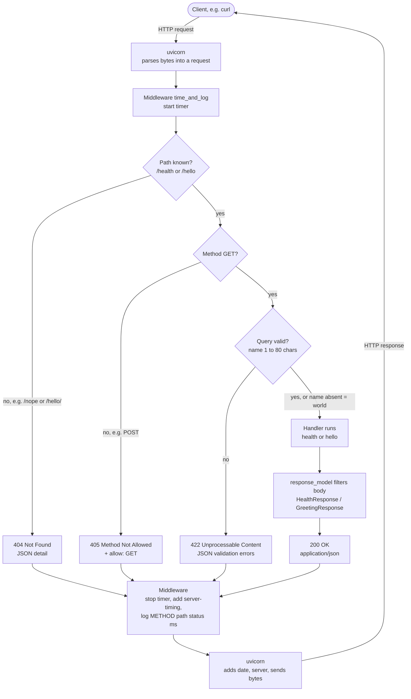

# 01 — Your first HTTP API

A minimal FastAPI service with exactly two JSON routes, `GET /health` and `GET /hello`, that validates its input and logs every request without leaking the query string.

## How to run

### 1. Create the environment (once)

```bash
conda env create -f environment.yml
conda activate apis24
```

This installs Python 3.13 and the exact versions pinned in `requirements.txt`
(FastAPI 0.162.0, uvicorn 0.54.0, pydantic 2.14.2, httpx 0.28.1, pytest 9.2.0).

### 2. Start the server

From this folder:

```bash
uvicorn app.main:app --no-access-log --log-config logging.json
```

On Windows you can double-click `run.bat` instead (or `run.bat 8001` for another port).

Both flags matter:

- `--no-access-log` turns off uvicorn's built-in access log, which prints the
  full query string (`GET /hello?name=...`) and would leak caller input.
- `--log-config logging.json` gives the app's own `app.access` logger a handler.
  Without it those log lines are silently dropped.

Then open <http://127.0.0.1:8000/hello?name=Nick>.

### 3. Run the tests

```bash
python -m pytest -q
```

Expected: `34 passed`.

## How a request flows through the app

Every request passes through uvicorn and our middleware, so **every** answer
(200, 404, 405, 422) gets a `server-timing` header and one log line. The status
code is decided at the first step that says no.



## One complete exchange

Captured live with `curl.exe -v "http://127.0.0.1:8000/hello?name=Nick"`
against the server started as above (2026-10-30). `>` lines are what the
client sent, `<` lines are what the server answered.

```text
> GET /hello?name=Nick HTTP/1.1
> Host: 127.0.0.1:8000
> User-Agent: curl/8.21.0
> Accept: */*
>
< HTTP/1.1 200 OK
< date: Fri, 30 Oct 2026 13:59:37 GMT
< server: uvicorn
< content-length: 27
< content-type: application/json
< server-timing: app;dur=2.08
<
{"greeting":"Hello, Nick!"}
```

### The request

| Line | Meaning |
|---|---|
| `GET /hello?name=Nick HTTP/1.1` | The **request line**: method `GET`, target `/hello` with query string `name=Nick`, protocol version. FastAPI routes on the path `/hello` and reads `name` from the query string. |
| `Host: 127.0.0.1:8000` | Which server the client meant. Required in HTTP/1.1. |
| `User-Agent: curl/8.21.0` | Which client sent the request. The API ignores it. |
| `Accept: */*` | The client accepts any media type. The API always answers JSON. |
| *(empty line)* | Ends the headers. A `GET` has no body, so the request is complete. |

### The response

| Line | Set by | Meaning |
|---|---|---|
| `HTTP/1.1 200 OK` | FastAPI | The **status line**. `200` because the route matched and `name` passed validation. |
| `date: Fri, 30 Oct 2026 13:59:37 GMT` | uvicorn | When the response was generated, always in GMT. |
| `server: uvicorn` | uvicorn | Which server software answered. |
| `content-length: 27` | FastAPI (JSON response) | Size of the body in bytes: `{"greeting":"Hello, Nick!"}` is exactly 27 bytes. |
| `content-type: application/json` | FastAPI (JSON response) | Tells the client how to parse the body (R03). |
| `server-timing: app;dur=2.08` | our middleware in `app/main.py` | Time the app spent on this request, in milliseconds. |
| *(empty line)* | | Ends the headers. |
| `{"greeting":"Hello, Nick!"}` | `hello()` + `GreetingResponse` | The body. `response_model=GreetingResponse` guarantees it has exactly one string field, `greeting` (R02). |

### The log line

The same request produced one line in the server log:

```text
2026-10-30 15:59:37,870 INFO app.access GET /hello 200 2.08ms
```

It records method, path, status and duration, and the `2.08ms` matches the
`server-timing` header. The name `Nick` and the query string are **not** in the
log: the middleware logs `request.url.path`, which leaves out the query string.
The log time is local (UTC+2), while the `date` header is in GMT, so 15:59 and
13:59 are the same moment.

## Error responses

Every error is JSON and deliberate (R05). Each row was checked against a live
server (2026-11-05) and is pinned by a test in `tests/test_api.py`.

| Request | Status | Body / headers | Why | Test |
|---|---|---|---|---|
| `GET /nope` | 404 Not Found | `{"detail":"Not Found"}` | No route for this path | `test_unknown_path_returns_404` |
| `GET /hello/` | 404 Not Found | `{"detail":"Not Found"}` | A trailing slash is a different path; `redirect_slashes=False` stops the default 307 redirect | `test_unknown_path_returns_404` |
| `GET /docs` | 404 Not Found | `{"detail":"Not Found"}` | Auto-generated docs are switched off (R01: exactly two routes) | `test_auto_generated_docs_routes_stay_disabled` |
| `POST /hello` | 405 Method Not Allowed | `{"detail":"Method Not Allowed"}` + `allow: GET` | The path exists, the method doesn't | `test_unsupported_method_returns_405` |
| `GET /hello?name=` | 422 Unprocessable Content | `string_too_short` | `min_length=1` | `test_hello_rejects_empty_name` |
| `GET /hello?name=<81 chars>` | 422 Unprocessable Content | `string_too_long` | `max_length=80` (R04) | `test_hello_rejects_name_longer_than_80_chars` |

The 422 body includes `"input"`, the rejected value echoed back to the caller.
Every error still gets a `server-timing` header and one `app.access` log line
(see the flowchart above).

A printable version of the flowchart is in [`docs/request-flow.pdf`](docs/request-flow.pdf).

## Theory

The theory behind this project (HTTP message parts, status codes, validation,
liveness vs readiness, measured edge cases, the four workbook questions and the
design decision) is in [`docs/theory.pdf`](docs/theory.pdf), built from
[`docs/theory.tex`](docs/theory.tex) with `tectonic theory.tex`.

## Evidence

Test results, latency measurements, the failures found and what is still untested:
[`EVIDENCE.md`](EVIDENCE.md). Raw latency output: [`evidence/`](evidence/).
