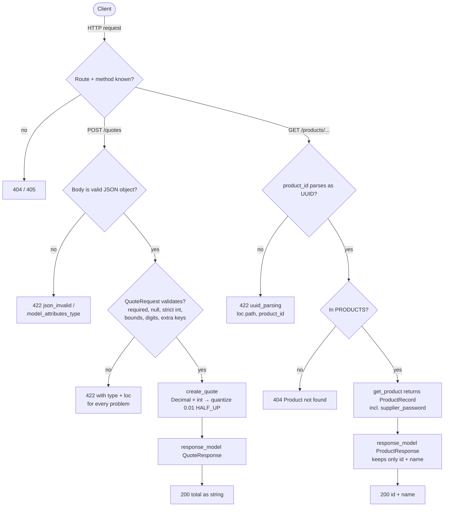

# 02 — Paths, query parameters and request schemas

A FastAPI service with two typed routes. `POST /quotes` multiplies a decimal
price by an integer quantity using exact decimal arithmetic. `GET /products/{product_id}`
validates a UUID path parameter. Every input is validated before the handler
runs: required vs optional, null vs absent, bounds, strict integers, unknown
fields. Internal fields never reach the response.

## How to run

### 1. Create the environment (once)

```bash
conda env create -f environment.yml
conda activate apis24
```

This uses the same versions as Project 01 (FastAPI 0.162.0, pydantic 2.14.2,
uvicorn 0.54.0, httpx 0.28.1, pytest 9.2.0). `decimal` and `uuid` are in the
standard library, so P02 adds no new dependencies.

### 2. Start the server

From this folder:

```bash
uvicorn app.main:app --no-access-log --log-config logging.json
```

On Windows you can double-click `run.bat` instead (or `run.bat 8001` for another port).

### 3. Run the tests

```bash
python -m pytest -q
```

Expected: `23 passed`.

## The contract

### `POST /quotes`

| Field | Type | Rule | Required |
|---|---|---|---|
| `unit_price` | decimal **string** | `≥ 0`, at most 12 digits in total, at most 4 after the point | yes |
| `quantity` | JSON **integer** | `1 ≤ quantity ≤ 1000`; strings and floats are rejected | yes |
| *anything else* | | rejected with `extra_forbidden` | |

Response: `{"total": "<decimal string, exactly 2 places>"}`, computed as
`unit_price × quantity`, rounded **half up** to cents.

### `GET /products/{product_id}`

`product_id` must be a UUID. Response: `{"id": "<uuid>", "name": "<string>"}`.
The stored record also has a `supplier_password`, which is never returned.

## How a request flows through the app

The status code is decided at the first step that says no. The handler only
ever sees values that already satisfy the contract.



## One complete exchange

Captured live with `curl.exe -v` against `uvicorn` on port 8002 (2026-11-05):

```text
> POST /quotes HTTP/1.1
> Host: 127.0.0.1:8002
> User-Agent: curl/8.21.0
> Accept: */*
> Content-Type: application/json
> Content-Length: 37
>
{"unit_price": "0.10", "quantity": 3}
< HTTP/1.1 200 OK
< date: Thu, 05 Nov 2026 14:20:42 GMT
< server: uvicorn
< content-length: 16
< content-type: application/json
<
{"total":"0.30"}
```

| Part | Meaning |
|---|---|
| `Content-Type: application/json` | Tells FastAPI to parse the body as JSON. Without it, FastAPI does not parse the body, and the request fails with 422 `model_attributes_type`. |
| `"unit_price": "0.10"` | A **string**, so the server can build the exact `Decimal("0.10")`. The float `0.1` cannot be stored exactly in binary. |
| `"quantity": 3` | A JSON integer. `"3"` or `3.0` would be a 422 (strict mode). |
| `{"total":"0.30"}` | Exactly `0.10 × 3`, rounded to 2 places. As a JSON number it would be `0.3` and lose the trailing zero. |

## Validation errors

Every rejection is a 422 whose `detail` list says **what** went wrong (`type`)
and **where** (`loc`), one entry per problem. Each row was seen on the live
server ([`evidence/live-2026-11-05.txt`](evidence/live-2026-11-05.txt)) and is
pinned by a test.

| Request | `type` | `loc` | Test |
|---|---|---|---|
| quantity `0` | `greater_than_equal` | `body, quantity` | T02 |
| quantity `2.5` | `int_type` | `body, quantity` | T03 |
| quantity `"3"` or `3.0` | `int_type` | `body, quantity` | strict-mode tests |
| quantity **absent** | `missing` | `body, quantity` | R02 |
| quantity **`null`** | `int_type` | `body, quantity` | R02 |
| quantity `1001` | `less_than_equal` | `body, quantity` | R04 |
| `unit_price` absent | `missing` | `body, unit_price` | T05 |
| `unit_price` `"-0.01"` | `greater_than_equal` | `body, unit_price` | R04 |
| `unit_price` `"1e100"` | `decimal_max_digits` | `body, unit_price` | R04 (was a **500**) |
| `unit_price` `"0.12345"` | `decimal_max_places` | `body, unit_price` | R04 |
| extra key `discount` | `extra_forbidden` | `body, discount` | R05 |
| typo `units_price` | `missing` **and** `extra_forbidden` | both names | R05 |
| `/products/not-a-uuid` | `uuid_parsing` | `path, product_id` | T04 |

A well-formed but unknown product ID is a **404** `{"detail":"Product not found"}`, not a 422.
The 422 means "this can never be valid". The 404 means "valid, but nothing is there".

## Decisions clients can rely on

SPEC.md asks for coercion and rounding choices to be written down before
clients depend on them.

### Rounding

- `total = (unit_price × quantity).quantize(Decimal("0.01"), rounding=ROUND_HALF_UP)`.
- **Half up**, not Python's default half even: `0.125` → `0.13` (half even would give `0.12`).
- Always exactly 2 decimal places: `"0"` → `"0.00"`.
- Never a signed zero: `"-0"` → `"0.00"` (`total + 0` after `quantize`).

### Bounds and why they are safe

`max_digits=12, decimal_places=4` caps the price at `99999999.9999`. The largest
total is therefore `99999999.9999 × 1000 = 99999999999.90`, about 13 digits.
That is well inside Python's default 28-digit decimal precision, so `quantize`
cannot fail. Before the bound, `"1e100"` made `quantize` raise `InvalidOperation`,
which became a **500**.

### Coercion

| Input | Accepted? | Why |
|---|---|---|
| `quantity: "3"`, `3.0`, `true` | ❌ 422 | `strict=True`: only a JSON integer |
| `unit_price: "0.10"` | ✅ | the intended form |
| `unit_price: 0.1` (JSON number) | ✅ → `0.10` | ⚠️ accepted; a float's precision is already lost at the client |
| `unit_price: "1E1"`, `" 0.10 "`, `"+0.10"`, `"1_0"` | ✅ | ⚠️ Python's `Decimal()` accepts exponents, surrounding spaces, `+` and `_` separators |
| `unit_price: "١٢"` (Arabic-Indic digits) | ✅ → `12` | ⚠️ `Decimal()` accepts any Unicode decimal digit |
| `unit_price: "-0"`, `"-0.00"` | ✅ → `"0.00"` | −0 passes `ge=0` (−0 == 0). The total is normalized with `+ 0`, so the sign never reaches the client (was `"-0.00"`, fixed 2026-11-05) |
| `unit_price: true`, `"0x10"` | ❌ 422 | not a decimal |
| `product_id` in uppercase, without hyphens, `{…}` or `urn:uuid:` | ✅ | Python's `UUID()` accepts all of them; the response always uses the canonical lowercase form |

The ⚠️ rows are documented, not endorsed. A strict `unit_price` would need a
pattern such as `^\d{1,8}(\.\d{1,4})?$` (see the design decision in the theory PDF).

### Fields

- Required: `unit_price`, `quantity`. There are no optional request fields yet.
- Unknown body keys are rejected (`extra="forbid"`).
- **Unknown query parameters are still ignored** (`?admin=true` → 200). `extra="forbid"` applies only to the body model.
- Safe to rely on in responses: `total` (quotes); `id`, `name` (products). Nothing else will appear.

## Theory

[`docs/theory.pdf`](docs/theory.pdf) (built from [`docs/theory.tex`](docs/theory.tex)
with `tectonic theory.tex`) covers missing vs null vs invalid vs zero, why money
isn't a float, rounding modes, lax vs strict coercion, extra fields and mass
assignment, internal vs public models, the workbook's four questions, the design
decision, the **project scope** and **links to every reference**.

## Evidence

Test results, the two independently found (and fixed) failures, the intentional failure and
what is untested: [`EVIDENCE.md`](EVIDENCE.md). Raw live output: [`evidence/`](evidence/).
